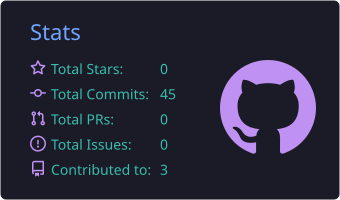
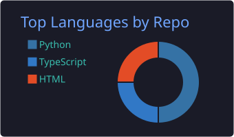

Oi, eu sou o Gabriel Bernardino, estudante e desenvolvedor em formação!

Tenho 17 anos e vou cursar Engenharia de Software na UniSenai, em Londrina/PR. Aprendo programação construindo projetos reais e publicando tudo aqui. Estou buscando minha primeira oportunidade em TI (Jovem Aprendiz ou estágio, 100% remoto).

 
  
  
  
  
  
  
  

## Projetos

* [AlphaRadar B3](https://github.com/Bersdev/Alpharadar-B3) ([demo](https://alpharadar-b3.up.railway.app/)): plataforma de análise de investimentos com motor de cálculo em Python (FastAPI) e dashboard em Next.js. 39 testes e CI no GitHub Actions.
* [Build in Public](https://github.com/Bersdev/Build_In_Public) ([app](https://build-in-public-rho.vercel.app/)): aplicativo para registrar e acompanhar a evolução nos estudos de programação, com FastAPI, React e PostgreSQL.

## Estatísticas

  
  

  
  

